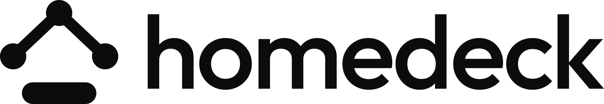
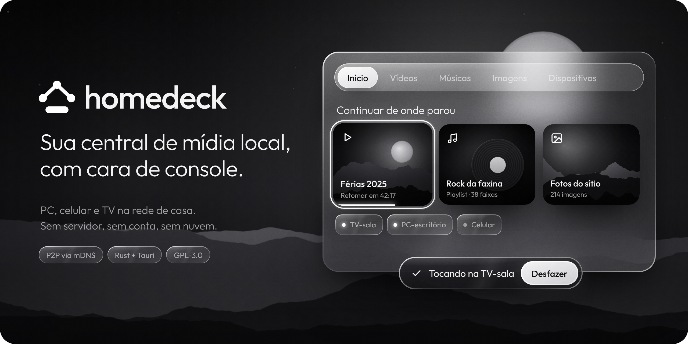

<div align="center">

<picture>
  <source media="(prefers-color-scheme: dark)" srcset="assets/brand/logo/homedeck-logo-horizontal-white.svg">
  
</picture>

<br>



**Your local media center, console-style, on every device you own — no server, no cloud.**

[](https://github.com/lucacasanova/homedeck/stargazers)
[](LICENSE)
[](https://github.com/lucacasanova/homedeck/actions/workflows/ci.yml)

[🌐 Website](https://lucacasanova.github.io/homedeck/en/) · [🇧🇷 Português](README.md) · [Roadmap](https://github.com/lucacasanova/homedeck/milestones) · [Discussions](https://github.com/lucacasanova/homedeck/discussions)

</div>

> [!NOTE]
> **Status: in development (M0 — Foundation).** A Linux preview build is produced by CI; there is no stable release yet. Star the repo to follow along.

## Why

Your videos, music and photos are scattered across a PC, a phone and an external drive. Watching them on the TV means copying files, USB sticks, or setting up a media server.

homedeck takes a different approach:

1. **Every device is a node.** No central server, no account, no cloud. Install it and it works.
2. **Console UI.** Fullscreen and fully usable with a TV remote, gamepad or arrow keys.
3. **Everything talks.** Browse the PC's library from the TV; send playback from your phone to the TV.

## Features

**MVP**
- 🎬 Video with subtitles, audio tracks and resume
- 🎵 Music by artist, album and folder, with queue, shuffle and repeat
- 🖼️ Photos with a viewer and slideshow
- 📡 Automatic device discovery on the home network (mDNS)
- 🔐 Login on every device, PIN pairing and encrypted connections
- 📺 Play on another device and remote-control it
- 🪟 Monochrome glass UI over a night scene or a per-device wallpaper

**Post-MVP (planned, with milestones):** file management (duplicates, quarantine, disk usage) · PC games on the TV from **official stores only** (Steam, EA app, Epic, GOG…) via Sunshine/Moonlight · Windows, macOS, iOS · store releases · SteamOS-style console session · remote access with end-to-end encryption.

## Platforms

| Platform | Priority | Status |
|---|---|---|
| Linux (Manjaro first; Arch, Ubuntu, Fedora…) | MVP | 🚧 in development |
| Android / Android TV | MVP | 📋 planned |
| Samsung TV (Tizen) | MVP | 📋 planned |
| Windows · macOS · iOS | post-MVP | 🔭 planned |

## Robust by design

- **Resilient startup (ADR 0010):** if a graphics driver crashes the UI before it opens, the app retries in compatibility modes (Mesa EGL, X11, software…), remembers what works and saves a local report. Nothing is sent without your click.
- **Signed automatic updates (ADR 0011)** for AppImage and Android; system packages update through your package manager.
- **Privacy:** your media never leaves your devices. Telemetry is **opt-in, off by default**, with a public event catalog ([TELEMETRY.md](docs/privacy/TELEMETRY.md), [PRIVACY.md](PRIVACY.md)).

## Architecture

| Layer | Technology |
|---|---|
| Core | Rust (`crates/core`), SQLite, ffmpeg |
| UI | React + Vite + TypeScript, Norigin spatial navigation ([ADR 0009](docs/adr/0009-ui-react-vite.md)) |
| Shell | Tauri 2 (Linux, Android, Android TV) · web app on Tizen |
| Network | mDNS/DNS-SD, HTTP Range, HLS, WebSocket, pinned TLS |

Docs: [architecture](docs/planning/ARCHITECTURE.md) · [vision](docs/planning/VISION.md) · [design](docs/design/DESIGN.md) · [brand guide](docs/design/GUIA-DE-MARCA.md) · [ADRs](docs/adr/) (docs are in Brazilian Portuguese; issues and PRs in English are welcome).

## Getting started (development)

```bash
pnpm env:check   # toolchain and system dependencies
pnpm install
pnpm dev         # native app with hot reload
pnpm check       # everything CI runs
```

## Contributing

Pick an issue labelled [`good first issue`](https://github.com/lucacasanova/homedeck/labels/good%20first%20issue), comment that you're on it, and follow [CONTRIBUTING.md](CONTRIBUTING.md): `type/N-name` branch, Conventional Commits signed off with `git commit -s` (DCO), PR linked to the issue. Every PR gets a security pre-scan, dependency review, CodeQL and, on request, a Claude review. Found a vulnerability? Use [private reporting](https://github.com/lucacasanova/homedeck/security/advisories/new), never a public issue.

The project is built with [Claude Code](https://claude.com/claude-code); its rules, skills and hooks are versioned in [`CLAUDE.md`](CLAUDE.md) and [`.claude/`](.claude/).

## License

Code: [GPL-3.0-or-later](LICENSE). Outfit font: [SIL OFL 1.1](assets/brand/fonts/OFL.txt).
