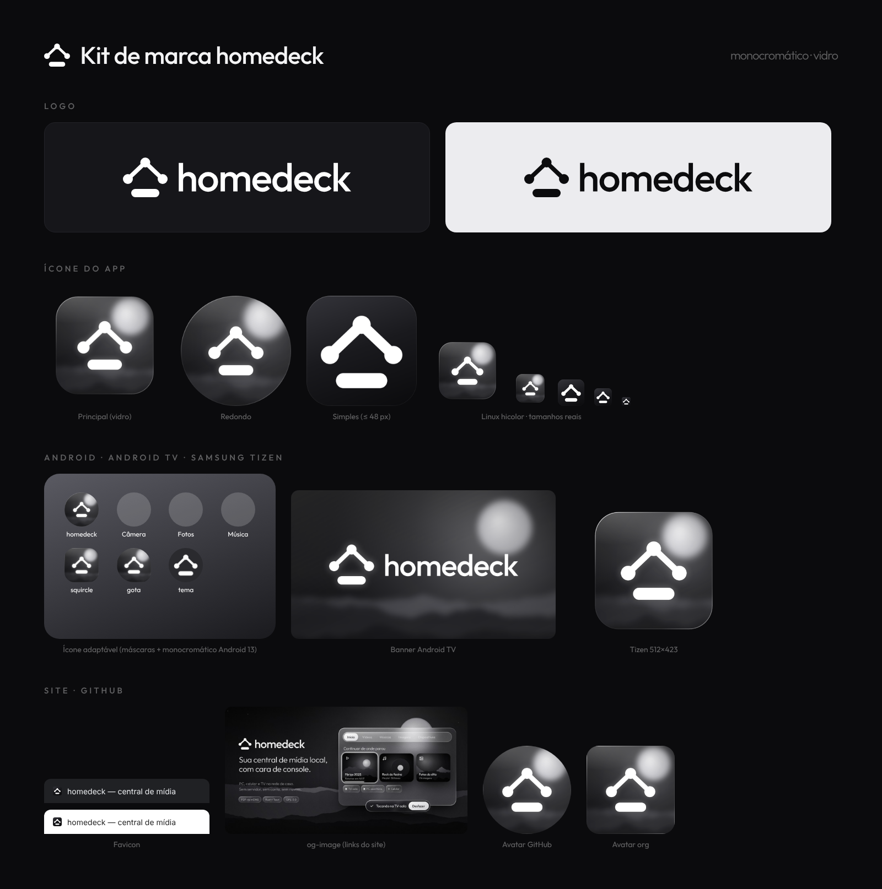

# Design

Identidade oficial do homedeck: **monocromático (grafite + branco), estilo vidro**. É uma interface de console (10-foot UI) com painéis de vidro sobre uma paisagem noturna ou sobre o papel de parede escolhido em cada dispositivo.

> **Fonte da verdade da marca:** [GUIA-DE-MARCA.md](GUIA-DE-MARCA.md). Se este documento divergir dele, vale o guia.

Este arquivo traduz o guia pra interface do app. Arquivos da marca: [`assets/brand/`](../../assets/brand/); mapa de uso: [BRAND.md](BRAND.md).



## Princípios

1. **Sem cor.** Só grafite, cinzas e branco. O destaque é o **branco 100%**, e a luz faz o papel da cor (brilho, reflexo, lua).
2. **Vidro de verdade.** Painéis translúcidos com blur, borda em gradiente (rim) e reflexo especular no topo.
3. **Cena ao fundo.** Paisagem noturna com montanhas, lua desfocada e granulado leve, ou o papel de parede do dispositivo.
4. **Feito pra sofá.** Tudo legível a 3 m e navegável só com setas + OK + voltar.

## Paleta

| Token | Valor | Uso |
|---|---|---|
| `--bg` | `#0B0B0D` | Fundo do app |
| `--bg-deep` | `#08080A` | Fundo da cena, bordas da tela |
| `--surface` | `#16161A` | Cartões sólidos quando não dá pra usar vidro |
| `--surface-2` | `#1A1A1E` | Listas, campos, meio do gradiente do ícone simplificado |
| `--ink` | `#F4F4F5` | Texto principal |
| `--ink-2` | `rgba(244,244,245,.62)` | Texto secundário |
| `--ink-3` | `rgba(244,244,245,.38)` | Texto terciário, desabilitado |
| `--accent` | `#FFFFFF` (100%) | Destaque: palavra-chave, foco, botão ativo |
| `--on-accent` | `#0C0C0E` | Texto sobre botão branco |

Hierarquia se faz com **opacidade do branco**, nunca com outra cor. Cinzas da paisagem: `#34343A` → `#1E1E22` → `#141417` → `#0D0D10` → `#070708`.

O ícone, a logo e a UI usam só esses valores. Não introduza cores de destaque. Estados como erro e sucesso usam ícone e texto; se for indispensável usar cor, crie um ADR antes.

## Tipografia

**Outfit** (licença SIL OFL 1.1). No app, instale com `pnpm add @fontsource/outfit` pra funcionar offline. Cópia de referência em [`assets/brand/fonts/`](../../assets/brand/fonts/).

| Peso | Uso |
|---|---|
| 300 | Títulos grandes e slogan; a palavra-chave vai em 500 e branco cheio ("Um toque. **Outra tela.**") |
| 400 | Texto corrido, rótulos |
| 500 | Logo, títulos de card, botões |
| 600 | Ênfase pontual ("Sem nuvem.") |

Nome "homedeck" e títulos grandes com espaçamento −2,7%; slogan −1,5%; sobretítulo em 500, maiúsculas, +25%.

Fallback: `Outfit, Inter, system-ui, sans-serif`. Mínimo de 24 px pra texto na TV (1080p).

## Vidro

Valores do kit (`assets/brand/fonte/common.css`), que são a referência oficial:

```css
.glass {
  background: linear-gradient(155deg,
    rgba(255,255,255,.20) 0%, rgba(255,255,255,.07) 38%,
    rgba(255,255,255,.035) 62%, rgba(255,255,255,.09) 100%);
  backdrop-filter: blur(var(--blur, 30px)) saturate(115%) brightness(1.12);
  box-shadow:
    0 50px 90px -30px rgba(0,0,0,.75),
    0 18px 40px -18px rgba(0,0,0,.55),
    inset 0 1.5px 0 rgba(255,255,255,.42),
    inset 0 -1px 0 rgba(255,255,255,.06),
    inset 0 0 40px rgba(255,255,255,.035);
}
/* rim: borda em gradiente de 1.6px (::before com mask xor) */
/* sheen: reflexo radial no canto superior esquerdo (::after) */
```

| Variante | Uso |
|---|---|
| `.glass` | Painéis, cards, navbar em pílula, chips de dispositivo |
| `.glass.solid` | Branco fosco: aba ativa, botão principal ("Desfazer") |
| `.glass.dark` | Vidro escuro sobre cenas claras, toasts |

## Formas

| Token | Valor | Uso |
|---|---|---|
| `--radius-window` | `28–30px` | Janelas e painéis |
| `--radius-card` | `20px` | Cartões de mídia |
| `--radius-pill` | `999px` | Navbar, botões, toasts, chips |
| `--radius-node` | `50%` | Nós (dispositivos) |
| `--blur` | `14px` (chips) a `34px` (janelas) | Blur do vidro |

## Componentes de referência (banner do README)

- **Navbar em pílula:** abas Início · Vídeos · Músicas · Imagens · Dispositivos. A aba ativa usa `.glass.solid`.
- **Card de mídia:** miniatura escura, ícone de linha no canto (▷ ♫ 🖼), título 500 e subtítulo `--ink-2`, barra de progresso branca embaixo pra "continuar".
- **Card em foco:** ver Foco abaixo.
- **Chips de dispositivo:** pílulas de vidro com um ponto de status (branco = online, `--ink-3` = offline).
- **Toast:** pílula de vidro escuro, com ✓, texto e um botão `.glass.solid` ("Desfazer").
- **Ícones:** só de linha, traço de 1.75 px, cantos arredondados, na cor `--ink`.

## Fundo

- **Padrão:** a cena da marca (`drawScene` em `assets/brand/fonte/common.js`), com montanhas em camadas, lua desfocada, estrelas e granulado.
- **Por dispositivo:** imagem local, cor sólida (`--bg`) ou "dinâmico" (a capa do item em foco, desfocada e escurecida).
- Foto escolhida pelo usuário é **convertida pra tons de cinza e escurecida**. A marca não tem cor, nem no fundo.
- Sempre com um overlay escuro, pra garantir contraste mínimo de 4.5:1 sob o vidro.
- A lua fica um pouco atrás de um painel de vidro: é isso que faz o efeito fosco aparecer.

## Foco (controle remoto e gamepad)

- `outline: 2.5px solid #fff; outline-offset: 3px`, mais `box-shadow: 0 0 40px rgba(255,255,255,.28)` e `scale(1.03)`.
- É o **único destaque** da navegação por controle remoto.
- O foco nunca some. Ao trocar de seção, ele volta pro último item visitado.

## Desempenho

`backdrop-filter` é caro em TV e em hardware fraco.

| Modo | Quando | Como |
|---|---|---|
| Completo | PC, celular recente | Blur real, rim e sheen |
| Leve | Tizen, Android TV, ou ativado pelo usuário | Sem `backdrop-filter`: fundo sólido `rgba(30,30,34,.85)` (valor do guia); o rim e o sheen continuam; o papel de parede vem pré-desfocado (gerado uma vez e guardado em cache) |

O app detecta a plataforma e escolhe o modo padrão. O usuário pode trocar nas configurações.

## Uso da marca

- Não estique, gire, recolora, contorne nem troque a fonte do logo, e não separe a barra dos nós. Use os SVGs de `assets/brand/logo/`.
- Respiro mínimo: a altura da barra do símbolo. Tamanho mínimo: 16 px (símbolo) e 20 px (logo horizontal).
- `*-white` vai sobre fundo escuro; `*-black` vai sobre fundo claro.
- Abaixo de 48 px, use o ícone `simples` (sem vidro nem lua).
- Peças novas (posts, banners) devem ser geradas pelos scripts de `assets/brand/fonte/`, pra manter a consistência.
