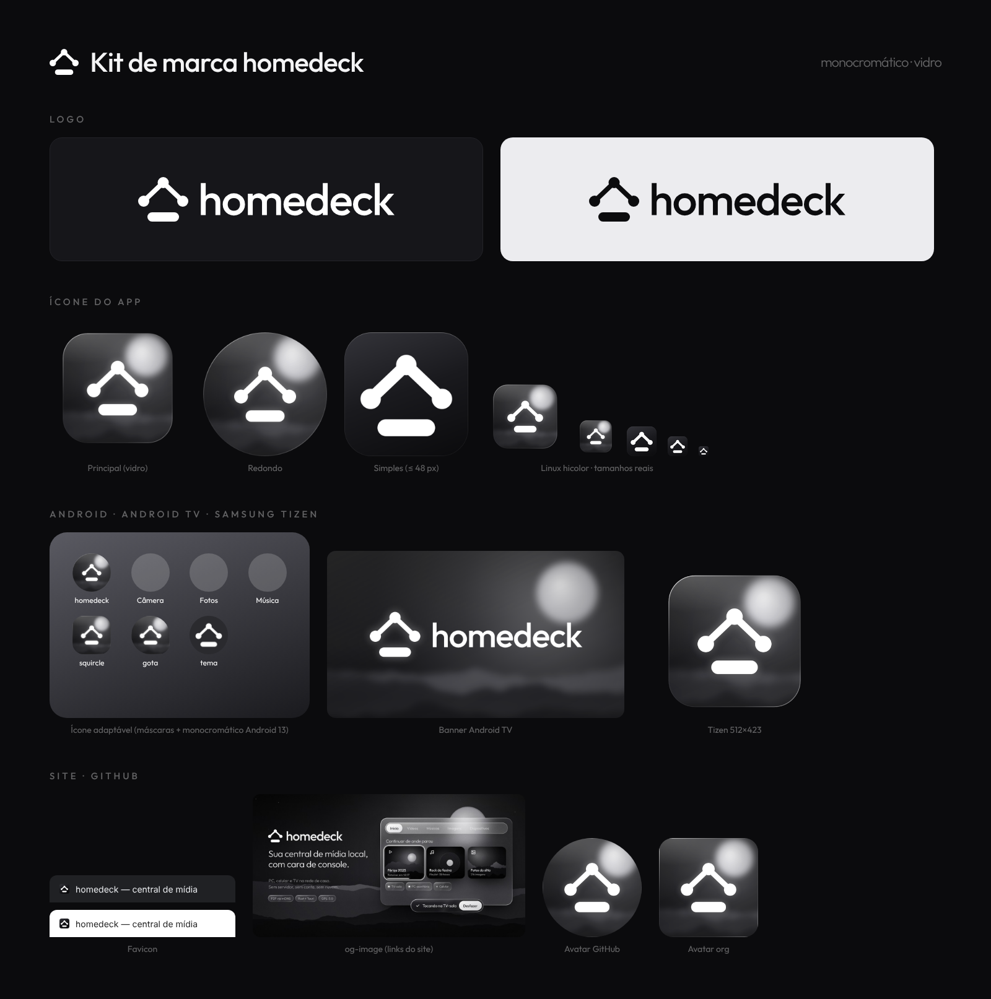

# homedeck — Guia de marca

Nov 3, 2026 · @Casanova

## Visão geral

A marca homedeck é monocromática (grafite e branco), feita de vidro fosco sobre uma paisagem noturna. Não existe cor de destaque: o que importa fica em branco cheio, o resto em branco com menos opacidade.

Três ideias guiam tudo:

- **Rede de casa.** O símbolo são três aparelhos (nós) ligados, com a barra do "deck" embaixo. Sempre que possível, PC, TV e celular aparecem como esses nós.
- **Console.** A interface é feita de painéis de vidro, foco com anel branco e avisos em pílula ("Tocando na TV-sala · Desfazer").
- **Noite tranquila.** O fundo padrão é uma serra com lua e névoa, em tons de cinza. A lua atrás do vidro é o que faz o efeito fosco aparecer.

Não fazer: usar verde ou qualquer cor de destaque, gradientes coloridos, sombras duras, contorno preto no símbolo ou o símbolo sobre fundo com pouco contraste.



## Logo

Use o logo horizontal por padrão; o símbolo sozinho só quando o nome já aparece por perto ou o espaço é quadrado.

| Peça | Arquivo | Quando usar |
| --- | --- | --- |
| Logo horizontal | `logo/homedeck-logo-horizontal-{white,black}.svg` | Cabeçalhos, README, site, slides |
| Logo vertical | `logo/homedeck-logo-vertical-{white,black}.svg` | Telas de abertura, espaços quadrados |
| Símbolo | `logo/homedeck-simbolo-{white,black}.svg` | Ícones, avatar, favicon, marca d'água |
| Wordmark | `logo/homedeck-wordmark-{white,black}.svg` | Quando o símbolo já está em outro lugar |

`white` vai em fundo escuro e `black` em fundo claro. Os SVG têm o texto convertido em curvas, então não dependem da fonte instalada. Há PNG de cada um em `logo/png/`.

**Geometria do símbolo** (viewBox 594 × 528): nós com raio 66, linhas com 58 de espessura e pontas arredondadas, barra de 374 × 110 com cantos totalmente arredondados. Na versão simplificada dos ícones pequenos a linha sobe para 78.

**No logo horizontal**, o espaço entre símbolo e nome é 148 unidades (cerca de 1/4 da largura do símbolo), e o nome vai em Outfit 500 com espaçamento de −2,7%.

**Respiro:** deixe em volta do logo, no mínimo, a altura da barra do símbolo.

**Tamanho mínimo:** 16 px de altura para o símbolo e 20 px de altura para o logo horizontal. Abaixo de 48 px use sempre a versão simplificada do ícone.

**Não fazer:** esticar, girar, trocar a fonte do nome, colorir o símbolo, aplicar contorno ou separar a barra dos nós.

## Cores

A paleta tem só grafite e branco. Para criar hierarquia, mude a opacidade do branco, nunca a cor.

| Token | Valor | Uso |
| --- | --- | --- |
| `--bg` | `#0B0B0D` | Fundo da página, `theme_color` do site |
| `--bg-deep` | `#08080A` | Fundo atrás da paisagem, cantos |
| `--surface` | `#16161A` | Cartões sólidos quando não dá para usar vidro |
| `--surface-2` | `#1A1A1E` | Meio do gradiente do ícone simplificado |
| `--ink` | `#F4F4F5` | Texto principal |
| `--ink-2` | `rgba(244,244,245,.62)` | Texto secundário, subtítulos |
| `--ink-3` | `rgba(244,244,245,.38)` | Legendas, rodapés, sobretítulos |
| `--accent` | `#FFFFFF` (100%) | Destaque: palavra-chave, foco, botão ativo |
| `--on-accent` | `#0C0C0E` | Texto sobre botão branco |

Cinzas da paisagem, do mais distante para o mais próximo: `#34343A` → `#1E1E22` → `#141417` → `#0D0D10` → `#070708`.

No modo claro (perfil claro do Instagram, logo `black`), o fundo é um gradiente de `#F6F6F7` a `#C9C9CE` e o símbolo fica em `#0C0C0E`.

## Tipografia

A fonte é a **Outfit** (Google Fonts, licença OFL), em quatro pesos. No projeto, instale com `npm i @fontsource/outfit` em vez de carregar do Google, para o app funcionar sem internet.

| Estilo | Peso | Tamanho de referência | Espaçamento |
| --- | --- | --- | --- |
| Nome "homedeck" | 500 | — | −2,7% |
| Título grande (posts) | 300, com a palavra-chave em 500 | 132 px em tela de 1080 | −2,7% |
| Slogan | 300 | 42–52 px | −1,5% |
| Texto de interface | 400 | 17–40 px | 0 |
| Botão | 500 | igual ao texto ao lado | 0 |
| Sobretítulo | 500, maiúsculas | 15–24 px | +25% |

O padrão de título da marca é fino com a parte importante em peso médio e branco cheio, como em "Um toque. **Outra tela.**"

## Estilo vidro

Todo painel é feito de quatro camadas: um preenchimento branco translúcido, o desfoque do fundo, uma borda em gradiente e um brilho no canto superior esquerdo. A classe abaixo é a mesma usada nas peças e pode ir direto para a interface do app.

```css
.glass {
  position: relative;
  isolation: isolate;
  background: linear-gradient(155deg,
    rgba(255,255,255,.20) 0%, rgba(255,255,255,.07) 38%,
    rgba(255,255,255,.035) 62%, rgba(255,255,255,.09) 100%);
  backdrop-filter: blur(var(--blur, 30px)) saturate(115%) brightness(1.12);
  box-shadow:
    0 50px 90px -30px rgba(0,0,0,.75),
    0 18px 40px -18px rgba(0,0,0,.55),
    inset 0 1.5px 0 rgba(255,255,255,.42),
    inset 0 0 40px rgba(255,255,255,.035);
}
/* borda em gradiente */
.glass::before {
  content: ""; position: absolute; inset: 0; border-radius: inherit;
  padding: var(--rim, 1.6px); pointer-events: none;
  background: linear-gradient(140deg, rgba(255,255,255,.85),
    rgba(255,255,255,.14) 28%, rgba(255,255,255,.03) 55%,
    rgba(255,255,255,.12) 78%, rgba(255,255,255,.55));
  -webkit-mask: linear-gradient(#000 0 0) content-box, linear-gradient(#000 0 0);
  -webkit-mask-composite: xor; mask-composite: exclude;
}
/* brilho */
.glass::after {
  content: ""; position: absolute; inset: 0; border-radius: inherit; pointer-events: none;
  background: radial-gradient(120% 70% at 18% -10%, rgba(255,255,255,.22), transparent 55%);
}
```

Variantes:

- **Botão ativo / aba selecionada** (`.glass.solid`): fundo `linear-gradient(160deg, rgba(255,255,255,.96), rgba(232,232,236,.88))`, texto `#0C0C0E`, halo `0 0 40px rgba(255,255,255,.18)`.
- **Aviso escuro** (`.glass.dark`): fundo `rgba(20,20,24,.55)` → `rgba(10,10,12,.62)`, para pílulas sobre a interface.
- **Foco de console:** `outline: 2.5px solid #fff; outline-offset: 3px`, mais `0 0 40px rgba(255,255,255,.28)` e `scale(1.03)`. É o único destaque da navegação por controle remoto.

Raios usados: 20 px nos cartões, 28–30 px nas janelas, 999 px nas pílulas e 50% nos nós. O desfoque vai de 14 px (chips) a 34 px (janelas). Em TV com GPU fraca, troque o `backdrop-filter` por um fundo sólido `rgba(30,30,34,.85)`: o visual quase não muda.

## Fundo

O fundo padrão é uma serra à noite, desenhada por código (função `drawScene` em `common.js`). Ele é sempre igual para a mesma semente, então pode ser gerado em qualquer tamanho sem emendas.

Camadas, de trás para frente:

1. Céu em gradiente vertical: `#060607` → `#121215` → `#09090B`.
2. Estrelas fracas na metade de cima (só nas peças grandes).
3. Brilho do luar: gradiente radial branco com 30–40% de opacidade no centro.
4. Lua: disco branco a 90%, com borda nítida. Fica sempre um pouco atrás de um painel de vidro, para o efeito fosco aparecer.
5. Quatro serras com ruído fractal, cada uma mais escura e com mais detalhe que a anterior, e névoa branca de 5–12% entre elas.
6. Vinheta escura nas bordas (45–55%) e granulação leve (8–10%) por cima de tudo.

No ícone do app, a mesma cena vai desfocada (cerca de 3% do tamanho do ícone), virando só luz e névoa. No app, o README prevê papel de parede por aparelho: a cena serve como padrão, e qualquer foto escolhida pelo usuário deve ser convertida para tons de cinza e escurecida para manter o contraste do texto.

## Ícone do app

O ícone tem duas versões: a de vidro para 64 px ou mais, e a simplificada para 48 px ou menos, onde o vidro vira borrão.

| Versão | Arquivo mestre (1024 px) | Quando usar |
| --- | --- | --- |
| Vidro, com margem | `app-icon/homedeck-icon-1024.png` | Desktop, Linux, Tauri, PWA "any" |
| Vidro, sem margem | `app-icon/homedeck-icon-fullbleed-1024.png` | Quando o sistema recorta: Play Store, iOS, avatar |
| Vidro, redondo | `app-icon/homedeck-icon-round-1024.png` | `ic_launcher_round` do Android legado |
| Simplificada | `app-icon/homedeck-icon-simples-1024.png` e `.svg` | 16–48 px, favicon, ícone escalável do Linux |

A versão de vidro segue a grade do macOS: quadrado arredondado de 824 px dentro de 1024, raio de cerca de 18%, símbolo com 56% da largura. A simplificada ocupa o quadro todo, com raio de 22% e símbolo com 74% da largura e linhas mais grossas.

No Android, o ícone adaptável separa o fundo (cena desfocada), a frente (símbolo com 41% do quadro, dentro da zona segura de 66 dp) e a versão monocromática para os temas do Android 13.

## Kit por plataforma

Todas as pastas do `homedeck-brand-kit.zip` seguem a estrutura que cada plataforma espera, então dá para copiar direto para o repositório.

| Plataforma | Pasta no kit | Destino no projeto | Observação |
| --- | --- | --- | --- |
| Tauri (desktop) | `tauri/src-tauri/icons/` | `src-tauri/icons/` | `icon.ico` já mistura a versão simplificada (16–48) e a de vidro (64–256) |
| Linux | `linux/icons/hicolor/` | `/usr/share/icons/hicolor/` | Mais o `homedeck.desktop` em `/usr/share/applications/` |
| Android | `android/app/src/main/res/` | `res/` do app Android gerado pelo Tauri | Inclui o XML do ícone adaptável; ícone da loja em `play-store-icon-512.png` |
| Android TV | `android-tv/.../drawable-xhdpi/banner.png` | `res/drawable-xhdpi/` | Declarar `android:banner="@drawable/banner"` no `<application>`; banner da loja 1280 × 720 |
| Samsung TV (Tizen) | `tizen/icon.png` | Raiz do app web | `<icon src="icon.png"/>` no `config.xml`; 512 × 423 |
| Site | `web/` | Raiz pública do site | Colar `head-snippet.html` no `<head>` e trocar `SEU-DOMINIO` |
| GitHub | `github/` | usado direto de `assets/brand/github/` + Configurações | Social preview em Settings → General → Social preview |

## Redes sociais

**Instagram.** A foto de perfil é o símbolo num quadrado de vidro sobre a paisagem, com tudo dentro do círculo central. Use a escura como padrão; a clara fica de reserva para campanhas.

O mosaico são três posts de 1080 × 1440 (formato 3:4, o mesmo da grade do perfil), cortados de uma arte contínua de 3240 × 1440. Juntos, os três desenham o próprio símbolo: PC, TV e celular são os nós, e o aviso "Tocando na TV-sala" é a barra.

- Postar na ordem **3-direita → 2-centro → 1-esquerda**, porque o post mais novo aparece à esquerda.
- Depois disso, publicar sempre em grupos de 3 (ou fixar os três) para o mosaico não desalinhar.
- Nos próximos mosaicos, manter textos e botões a pelo menos 60 px das emendas entre os posts; só linhas e fundo podem atravessar.

**GitHub.** O README usa `readme-banner.png` (2560 × 1280, cantos transparentes) ou o logo que troca sozinho entre tema claro e escuro, com o trecho de `github/README-snippet.md`. A prévia de link é `social-preview.jpg` (1280 × 640, 124 KB, abaixo do limite de 1 MB). O avatar é `avatar-1024.png` e funciona tanto no círculo de usuário quanto no quadrado de organização.

## Como regenerar

Todas as peças são geradas por código, que está em [`assets/brand/fonte/`](../../assets/brand/fonte/). Rodar `./build.sh` refaz tudo; testei e a saída é idêntica à entregue. No repositório, o kit inteiro fica em `assets/brand/` e o mapa de uso em [BRAND.md](BRAND.md).

```bash
# uma vez
npm i -D playwright && npx playwright install chromium
pip install pillow uharfbuzz fonttools brotli

# sempre que mudar algo
./build.sh                 # gera tudo em dist/
OUT=/outro/lugar ./build.sh
```

O script roda nesta ordem:

1. Renderiza as cenas grandes no Chromium: mosaico, banner do README, social preview, og-image e fotos de perfil.
2. Renderiza o ícone em nove variantes (vidro, sem margem, redondo, simplificada, fundo, frente, monocromático, banner de TV, Tizen).
3. `slice.py` corta o mosaico em três posts e monta a prévia da grade.
4. `logos.py` gera os SVG com o texto em curvas e `svg2png.js` faz os PNG.
5. `kit.py` redimensiona e organiza tudo por plataforma, incluindo .ico, .icns, XML do Android e manifest do site.

| Quero mudar… | Onde |
| --- | --- |
| Textos dos posts ou do banner | `mosaic.html`, `readme.html` |
| Paisagem, lua, névoa | `glows`, `moon` e `ridges` na chamada de `drawScene` de cada página |
| Receita do vidro | `.glass` em `common.css` |
| Forma do símbolo | `markSVG` em `common.js` e `MARK` em `logos.py` (manter os dois iguais) |
| Tamanhos ou pastas das plataformas | `kit.py` |

## Pendências e decisões em aberto

- [ ] Confirmar na documentação da Samsung o tamanho do ícone Tizen (usei 512 × 423) antes de publicar na loja.
- [ ] Trocar `SEU-DOMINIO` no `head-snippet.html` quando o site tiver endereço.
- [ ] Definir se a interface do app usa o vidro em todas as telas ou só em painéis flutuantes, para não pesar em TVs fracas.
- [ ] Criar a versão Windows e macOS do ícone quando essas plataformas entrarem no plano (o kit já tem .ico, .icns e os Square\*Logo, mas sem teste real).
- [ ] Próximo mosaico do Instagram: seguir as regras de emenda em Redes sociais.
- [ ] Reduzir o `readme-banner.png` (3,2 MB) se o carregamento do README incomodar.
